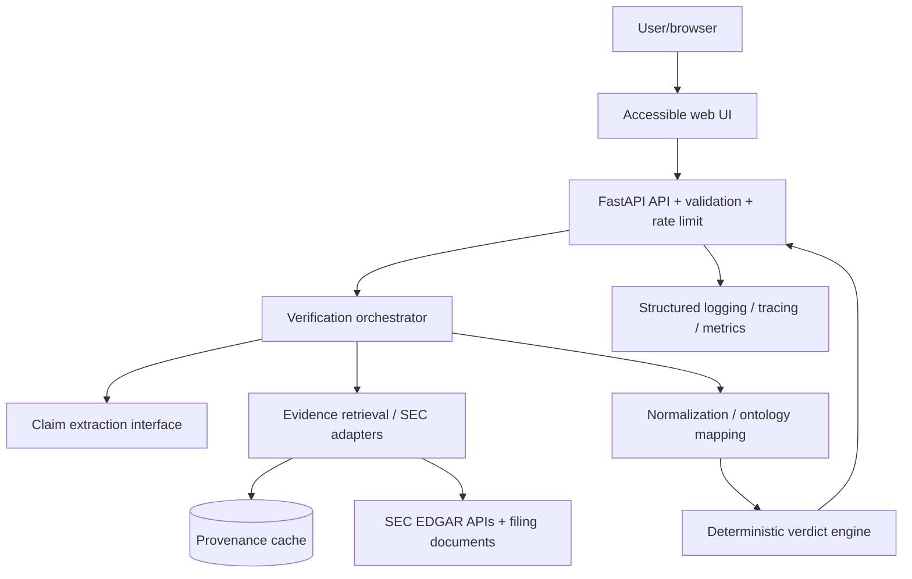

# System Architecture & Design
Status: proposed. Preserve existing system as reference; implement modularly.

## Context / component diagram

## Trust boundaries
Untrusted user claim; external SEC API/filing HTML; optional LLM provider; browser; cache/database; operator secrets. Treat SEC HTML as data, not executable instructions. LLM outputs are untrusted structured proposals.

## Pipeline
Validate input -> entity extraction -> disambiguate issuer/CIK -> identify concept/period/context -> fetch data with provenance -> normalize numeric facts -> evidence match -> deterministic compare or abstain -> result + traceable sources. Every step writes a reason code and timing without logging unneeded sensitive text.

## Technical architecture choices
- Python FastAPI for API and strict Pydantic request/response schemas.
- Separate modules: claim_parser, issuer_registry, taxonomy, evidence_provider, normalization, verdict_engine, persistence, evaluation.
- Provider interface supports SEC fixture adapter and production SEC adapter; use yfinance only for explicitly labeled market context, NOT the source of filing truth.
- PostgreSQL optionally for result/evidence records and audit history; MVP may use read-through cache plus durable fixture files; decide via ADR.
- Redis optional for shared rate limits/jobs; never use a per-process dict for distributed enforcement.
- Prefer modular monolith before service decomposition; keep provider ports explicit.
- Timeout, bounded retries with jitter, circuit breaker, result TTL with retrieval provenance; never hide upstream failures as zeros.

## Data lifecycle
Classify: public filing facts, user-submitted claim, API credentials, optional history. Separate claims from evidence and implement retention/deletion rules. Provide data provenance and as-of semantics.

## Deployment topology
Browser -> CDN/WAF -> application -> managed data store/cache -> SEC API. Background ingestion or batch processing is an optional later phase. Keep sandbox/staging separate from production.

## ADRs required
001 primary source strategy; 002 verdict taxonomy; 003 taxonomy mapping; 004 data store; 005 extraction baseline vs LLM; 006 auth model; 007 caching/refresh; 008 deployment selection; 009 supported jurisdictions.
